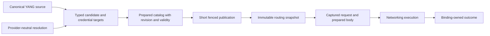

# Architecture Review: 2026-10-19

## Findings

### R1. Redact secrets at the input boundaries

**Priority: P2. Reproduced formatting exposure.**

Public CLI input types derive `Debug` while storing shared secrets and PSKs in ordinary strings or vectors.
Formatting `CliSecurity`, `CliSecurityInputs`, or `PskKeyMaterial` exposes their contents.
Enclosing input structures inherit this behavior.
`SonicTacacsTables` also derives `Debug` over raw ConfigDB hashes that can contain `passkey`.
No production logging sink was established for these values.

Evidence:

- [CLI security inputs](../libraries/tacacsrs_config/src/input/model.rs#L156).
- [PSK input representation](../libraries/tacacsrs_config/src/input/model.rs#L280).
- [ConfigDB snapshot representation](../libraries/tacacsrs_sonic/src/mapping.rs#L59).

Use existing secret types in the input model, or add explicit redacted formatting.
For raw table snapshots, omit values from `Debug` rather than maintaining an incomplete list of secret column names.
Preserve useful table names and row counts.

Verification: a temporary integration probe confirmed exposure in the three CLI types with a fixed test sentinel.
The probe was removed after execution.
The ConfigDB case is a source finding, not an executed probe.

Acceptance: ordinary and pretty `Debug` exclude sentinels from direct values and enclosing values.
Test shared secrets, raw PSKs, base64 PSKs, and ConfigDB credential columns.

### R2. Preserve nested YANG choices through generation and validation

**Priority: P2. Reproduced parser-contract defect.**

The generator flattens nested choice fields but discards the nested `ChoiceGroup`.
The generated identity metadata places `certificate` and `tls13-epsk` together in one outer case.
The validator checks their combined presence, not their mutual exclusion.
Consequently, `parse_yang_json` accepts a direct client identity containing both alternatives.
`prepare_endpoint` rejects that combination later.
This is a schema-validation failure, not evidence that an invalid endpoint connects.

Evidence:

- [Discarded nested choice](../libraries/tacacsrs_config/yang/plugins/yang2rust.py#L1043).
- [Generated outer choice](../libraries/tacacsrs_config/src/generated.rs#L406).
- [Client identity validation](../libraries/tacacsrs_config/src/validation.rs#L241).
- [Later endpoint rejection](../libraries/tacacsrs_config/src/prepare/endpoint.rs#L74).

Preserve the nested constraint and its parent-case activation condition during generation.
Generate an authentication enum where practical, or retain explicit nested metadata with behavioral validation.
Do not enforce every nested mandatory choice unconditionally when its parent case is absent.
Extend the coverage audit to keystore inline choices rather than inspecting only emitted TACACS+ constants.

Verification: a temporary probe confirmed that certificate-only, EPSK-only, and combined identities all parse.
It used the repository's existing illustrative credential shape and performed no network I/O.
The probe was removed after execution.

Acceptance: a minimal nested-choice generator fixture preserves both levels and conditional mandatory semantics.
Valid single alternatives pass, combined alternatives fail at parsing, and incomplete inline key definitions receive behavioral tests.
Regeneration remains deterministic, and existing secret annotations remain intact.

### R3. Preserve secret ownership in packet codecs

**Priority: P2. Confirmed secret-lifetime gap.**

The prepared endpoint protects its obfuscation key with `SecretBytes`.
Connection construction copies that key into ordinary vectors.
The packet reader and writer retain those vectors without the same zeroization contract.
Promotion can create further copies.
This is not evidence of a remote disclosure.

Evidence:

- [Dedicated connection construction](../libraries/tacacsrs_networking/src/connection/dedicated/mod.rs#L48).
- [Multiplexed connection construction](../libraries/tacacsrs_networking/src/connection/multiplexed/mod.rs#L96).
- [Reader key storage](../libraries/tacacsrs_networking/src/codec/reader.rs#L39).
- [Writer key storage](../libraries/tacacsrs_networking/src/codec/writer.rs#L17).

Use `SecretBytes` throughout connection and codec ownership.
Consider a shared `Arc<SecretBytes>` only if it removes copies across the reader, writer, and promotion.
Keep the public API free of unnecessary pointer types.
Do not claim that this change zeroizes every protocol or TLS buffer.

Acceptance: existing obfuscation, dedicated exchange, promotion, and shutdown tests pass.
The connection-owned key allocations retain the protected type until their final owner drops.

### R4. Make transport selection single-assignment

**Priority: P2. Confirmed public API footgun.**

`PreparedEndpoint::with_psk` and `with_certificate_tls` replace the complete transport configuration.
A caller can attach mandatory certificate evidence, then replace the transport and silently discard that policy.
The canonical configuration adapter uses a disciplined sequence, so this is not an observed daemon failure.

Evidence: [endpoint transport selectors](../libraries/tacacsrs_networking/src/endpoint.rs#L62).

Prefer separate TCP, certificate-TLS, and PSK constructors, or a builder that selects transport once.
Attach revocation evidence to certificate-TLS configuration before final endpoint construction.
Keep host guards, counters, and execution controls separate from security selection.

Acceptance: a test rejects transport re-selection after security policy attachment, or the API makes that sequence impossible.
Keep the existing immediate rejection of required OCSP or CRLs on incompatible transports.

### R5. Keep credential installation targets typed

**Priority: P2. Structural opportunity, not a demonstrated runtime defect.**

Configuration already identifies credential destinations with `CentralCredentialUsage`.
Planning reduces the destination to a diagnostic field path.
Materialization then reconstructs that meaning through string comparisons and a CA-versus-peer boolean.
Adding a credential kind requires synchronized changes across these representations.

Evidence:

- [Typed reference usage](../libraries/tacacsrs_config/src/central_references.rs#L12).
- [Resolution planning](../libraries/tacacsrs_config/src/prepare/planning.rs#L26).
- [String-based installation](../libraries/tacacsrs_config/src/prepare/materialization.rs#L246).

Keep a configuration-owned map from resolution slots to typed installation targets.
Match the target and resolved credential together.
Derive field paths only for diagnostics.
Keep the provider contract independent of YANG and retain closed-result validation.

Acceptance: every supported reference kind materializes through a typed target.
Wrong-kind, missing-slot, duplicate-slot, and unresolved-reference cases still fail.
The canonical source remains unchanged.

### R6. Prepare an operation once before admission

**Priority: P2. High-value structural opportunity.**

The typed agent path constructs and serializes a complete request to calculate its admission size.
The send path reconstructs the request, and networking serializes it again.
Public mutable operation fields also require repeated validation at trusted boundaries.

Evidence:

- [Authorization sizing and execution](../libraries/tacacsrs_agent/src/services/client_api/upstream_bridge/authorization.rs#L24).
- [Logical request conversion](../libraries/tacacsrs_protocol/src/operations/wire.rs#L95).
- [Networking serialization](../libraries/tacacsrs_networking/src/client/exchange.rs#L111).

Introduce an immutable prepared operation after input validation.
Retain its validated body and length for admission and safe retry.
Keep packet headers, session IDs, sequence validation, and transport outcomes in networking.
Keep PAP material protected and bounded throughout preparation.
Do not add an independent operation schema or cache mutable requests.

Acceptance: admission length equals transmitted body length for every operation.
Malformed fields fail before admission and upstream I/O.
Direct and IPC response interpretation remains consistent.
Measure allocation or serialization changes before claiming a performance gain.

### R7. Carry one prepared catalog candidate into publication

**Priority: P2. High-value structural opportunity with medium implementation risk.**

Materialization returns generated server values and validity metadata.
Publication reduces these values to shared generated servers, validates them again, and constructs native prepared endpoints.
Coordinator state remains locked across the service publication-lock wait and native preparation.
The stages have different checks, so deleting repeated calls is not a sufficient refactor.

Evidence:

- [Materialization and publication merge](../libraries/tacacsrs_agent/src/runtime/materialization_coordinator.rs#L285).
- [Service publication boundary](../libraries/tacacsrs_agent/src/runtime/client_service/engine.rs#L268).
- [Native preparation before commit](../libraries/tacacsrs_agent/src/upstream/manager/publication.rs#L297).
- [Materialization checks](../libraries/tacacsrs_config/src/prepare/materialization.rs#L425).
- [Runtime readiness checks](../libraries/tacacsrs_config/src/prepare/readiness.rs#L18).

Introduce a derived prepared candidate containing source metadata, prepared endpoint identity, validity, and the admitted revision.
Prepare outside the final commit lock where possible.
Recheck the revision, runtime closure, retained-server relationships, and validity immediately before publication.
Keep the canonical source separate and unchanged.
Retain complete-catalog checks after a partial credential refresh merges retained and replaced servers.

Acceptance: rejected and cancelled candidates never alter the active snapshot.
Unchanged endpoints retain counters and connection identity.
Late preparation cannot publish over newer source or credential observations.
Preparation does not renew earlier monotonic validity bounds.

### R8. Encode coordinator states before considering an actor

**Priority: P3. Structural opportunity.**

`CoordinatorState` stores related desired fields as separate options.
It also stores parallel active-server and lifetime collections, active and withdrawn revisions, and expiry flags.
The relationships are meaningful, but readers must reconstruct valid combinations across multiple methods.

Evidence: [coordinator state](../libraries/tacacsrs_agent/src/runtime/materialization_coordinator.rs#L27).

Group filtered source, proxy policy, and dependency knowledge into one explicit state.
Group applied material and its revision separately from withdrawn material.
Preserve the distinction between unknown dependencies and known-empty dependencies.
Also preserve an applied empty catalog as distinct from no publication.

A small revision-fenced transition function can handle admitted observations and prepared results.
It need not become an actor or own expensive I/O.
An actor is justified only if it removes locks and callbacks without adding unbounded queues or blocking independent expiry monitors.

Acceptance: state-transition tests cover source rejection, both expiry orders, provider recovery, and superseded preparation.
The atomic publication callback remains non-awaiting.

### R9. Narrow the public runtime update surface

**Priority: P3. Public API simplification.**

`TacacsClientService` exposes populated and waiting constructors, several server-reload variants, prepared-policy reload, and canonical policy admission.
The daemon uses a waiting service followed by configuration and policy supervisors.
Direct reload methods remain useful for tests and embedding, but also bypass coordinated materialization bookkeeping by design.
Callers must understand which update path owns the postconditions.

Evidence: [construction and update APIs](../libraries/tacacsrs_agent/src/runtime/client_service.rs#L161).

Prefer one supervised server-update entry point and one canonical policy-update entry point.
Keep lower-level publication operations private unless an actual embedding workflow needs them.
If both supervised and unmanaged embedding remain supported, expose explicit modes with distinct contracts.
Do not force source and policy updates into one transaction: they are independent observations.

Acceptance: the daemon has one clear construction path.
Public examples demonstrate supervised embedding and terminal shutdown without internal revision or callback knowledge.
Server-only and policy-only updates preserve unrelated state.

### R10. Remove request-owned forwarding, not routing ownership

**Priority: P3. Small internal API simplification.**

Outcome recording forwards through `OperationRouter`, `UpstreamManager`, and the bound endpoint.
The middle outcome methods add no behavior.
Some reservation operations also compute entirely from the captured lease rather than the manager's current state.

Evidence:

- [Service-scoped router](../libraries/tacacsrs_agent/src/upstream/router.rs#L106).
- [Outcome forwarding](../libraries/tacacsrs_agent/src/upstream/manager/binding.rs#L88).
- [Typed attempt bookkeeping](../libraries/tacacsrs_agent/src/services/client_api/upstream_bridge/routed.rs#L126).
- [Raw attempt bookkeeping](../libraries/tacacsrs_agent/src/services/tacacs_proxy/upstream_bridge/session.rs#L257).

Move request-owned admission methods onto the captured request and outcomes onto the binding.
Share a narrow outcome operation between typed and raw attempts only where their semantics match.
Retain service identity at capture, manager-owned publication, generation-aware observations, and failure guards.
Do not create another retry engine: both paths already use `run_with_failover`.
Do not merge complete exchanges: the raw path owns session pinning, continuation, remapping, and physical reply acknowledgement.

Acceptance: reload-during-retry tests retain one request snapshot.
Downstream continuation waits do not mark upstream failure.
Cancellation invalidates only the captured connection generation.

### R11. Preserve host and port as structured runtime values

**Priority: P3. Public API simplification.**

Configuration has separate host and port fields, then formats them into a string for `PreparedEndpoint`.
The resolver reparses the string and uses colon presence to infer whether a port exists.
Input normalization already contains a separate IPv6-aware parser.

Evidence:

- [Server address formatting](../libraries/tacacsrs_config/src/extensions.rs#L47).
- [Endpoint string storage](../libraries/tacacsrs_networking/src/endpoint.rs#L43).
- [Destination reparsing](../libraries/tacacsrs_networking/src/destination.rs#L25).
- [Input address parser](../libraries/tacacsrs_config/src/input/address.rs#L12).

Use a schema-free address type with a DNS-or-IP host and explicit port in networking.
Pass canonical fields directly and format only for display.
Keep one parser for string-based entry points.
Do not replace a DNS name with a permanently resolved `SocketAddr`.
Fresh resolution and execution-time loop guards remain necessary.

Acceptance: DNS, IPv4, bracketed IPv6, bare IPv6 input, omitted ports, and malformed explicit ports have one tested interpretation.
Address parsing performs no network I/O.

### R12. Define release products once

**Priority: P3. Delivery simplification.**

The same product records appear in the CI caller, PR caller, reusable-workflow default, and Linux rehearsal.
Cargo metadata already owns package membership and target names.
It does not own the deliberate decision to release a particular product on a particular platform.

Evidence:

- [CI product matrix](../.github/workflows/ci.yml#L123).
- [PR product matrix](../.github/workflows/pullrequest_workflow.yml#L50).
- [Reusable product default](../.github/workflows/reusable-pipeline.yml#L71).
- [Rehearsal product records](../.github/steps/release-manifest/rehearse_linux.py#L67).
- [Shared Cargo inventory](../.github/steps/cargo-metadata/workspace.py#L1).

Create one explicit product registry and derive each platform matrix and rehearsal selection from it.
Validate its package and artifact names against Cargo metadata.
Do not automatically enroll every workspace member as a release product.
Keep independent expected-value tests for supported products rather than deriving every assertion from the registry itself.

Acceptance: adding a product changes one registry and deliberate contract expectations.
Windows remains direct-mode `tacon` only.
Experimental crates remain excluded, and ARMhf execution gates remain required.

### R13. Share owned file-observation mechanics

**Priority: P3. Local structural opportunity.**

Configuration and policy file observations duplicate debounce, retained reads, failure-priority selection, and drop handling.
`directory_watch` shares only part of that machinery.
The two observations need separate parsing and acceptance contracts, not separate implementations of the same cancellation rules.

Evidence:

- [Configuration observation](../libraries/tacacsrs_config/src/source/file.rs#L187).
- [Policy observation](../libraries/tacacsrs_config/src/source/policy.rs#L189).

Extract a private owned file-observation mechanism beneath the two public contracts.
Keep notification setup before the baseline read and retain pending work across cancelled `next()` calls.
Do not merge Redis observation, credential-directory watching, and file observation into one universal watcher.

Acceptance: existing atomic replacement, cancellation, directory-loss, and platform-specific tests pass for both consumers.
No detached reload worker replaces observation ownership.

### R14. Make whole-candidate preparation limits explicit

**Priority: P3. Resource-contract opportunity.**

Servers resolve sequentially, and each server's credential requests resolve sequentially.
HTTP limits apply to each evidence request, not to the complete candidate.
Slow successful requests can therefore accumulate preparation time and retained evidence.
A four-fetch semaphore limits simultaneous HTTP work, not total candidate work.

Evidence:

- [Sequential server materialization](../libraries/tacacsrs_config/src/prepare/materialization.rs#L194).
- [Sequential plan execution](../libraries/tacacsrs_credential_resolution/src/resolver.rs#L37).
- [Per-fetch HTTP limits](../libraries/tacacsrs_credential_http/src/resolver.rs#L244).

Specify candidate-level time, request-count, and retained-material limits at the orchestration boundary.
Keep runtime scheduling outside the provider-neutral contract.
Define cancellation and deterministic failure ordering before adding bounded concurrency.
Do not assume identical references are interchangeable across request contexts when considering deduplication.
This finding does not establish an absent timeout in every embedding caller.

Acceptance: a slow provider cannot stop independent expiry or host shutdown.
An oversized candidate fails without partial publication, and cancellation releases fetch capacity.

### R15. Take the small deletion opportunities

**Priority: P3. Low-risk follow-up work.**

| Surface | Current cost | Smaller implementation |
| --- | --- | --- |
| [IPC accounting and authorization](../libraries/tacacsrs_ipc/src/client.rs#L125) | Owned requests use borrowed conversions and clone their fields. | Use the existing consuming conversions. |
| [Load-test scheduler](../executables/tacon/src/batch/executor/common.rs#L228) | Stores every Boolean result, then recounts successes already tracked by progress. | Drain in-flight work and use the existing completion count. Preserve failure and cancellation behavior. |
| [Emulator connection setup](../libraries/tacacsrs_agent_ipc_emulator/src/client.rs#L109) | Repeats IPC Unix/TCP channel construction. | Expose one narrow endpoint connection method and remove duplicate connector-only dependencies. |
| [Emulator policy loading](../libraries/tacacsrs_agent_ipc_emulator/src/policy.rs#L80) | Source loading, data attachment, and startup can each compile the same policy. | Separate load/decode from explicit compilation. Keep compile-before-swap on replacement. |
| [Bash request construction](../libraries/tacacsrs_bash_plugin/src/authorization.rs#L21) | Assembles arguments separately from the existing domain builder. | Use that builder while preserving ordering and mandatory `protocol=ssh`. The convenience `.protocol()` method is not equivalent. |

Acceptance: focused tests protect each deleted implementation's observable contract.
Do not add a new crate or a generic RPC framework for these changes.

## Architecture Assessment

Keep the current crate direction.
The main remaining cost lies inside ownership boundaries, not in the number of crates.
The protocol, networking, credential contracts, configuration adapter, IPC adapter, and daemon have distinct reasons to exist.

The target is a shorter preparation and execution path:



This diagram does not merge source revisions, runtime generations, counter epochs, or connection generations.
Those identities protect different lifetimes.

### Internal APIs

Keep connector generics and their `Send` regression tests.
Remove pure forwarding only when the receiving type already owns the relevant data.
Use typed candidate states and installation targets instead of strings, parallel options, or undocumented stage assumptions.
Keep expensive work outside short publication transitions, with a final revision check.

### External APIs

The Rust entry points need clearer prepared-state and update-mode contracts.
The wire protocol and IPC contract already have useful ownership separation.
Keep conservative IPC delivery facts and reusable channels.
Keep RFC 7951 diagnostics JSON as a deliberate boundary, rather than adding a second complete diagnostics schema in protobuf.

Keep the Bash ABI small and synchronous.
Its caller must wait for authorization.
Do not cache a global channel without evidence about Bash fork and callback lifetimes.
The session wrapper remains an experiment, not a reason to generalize production process-control APIs.

### Contract Map

| Contract | Assessment |
| --- | --- |
| Rust protocol operations and exchanges | Retain the pure shared model. R6 introduces an explicit validated preparation boundary without another operation schema. |
| Rust networking construction and execution | R4 replaces security re-selection, and R11 replaces string-only addresses. Keep absolute deadlines and explicit close/join ownership. |
| Rust configuration and providers | R2 repairs parser postconditions. R5 keeps destinations typed, while R7 makes prepared-stage postconditions explicit. |
| Rust agent embedding | R9 distinguishes supervised operation from lower-level updates. Do not require hosts to understand publication callbacks. |
| TACACS+ wire protocol | Preserve RFC 8907 framing, sequence/session checks, first-response single-connect negotiation, and transmission-safe retry. No replacement protocol is proposed. |
| Desired and operational YANG JSON | Preserve RFC 7951 representation and canonical configuration. Operational snapshots remain read-only and are not accepted as desired configuration. |
| Protobuf service and SDK | Preserve domain conversion, reusable channels, validated failure facts, and conservative unknown outcomes. No additional generic RPC layer is justified. |
| Diagnostics RPC | Keep bounded RFC 7951 JSON as the complete snapshot. Standard health remains a separate contract. New typed projections need a specific consumer before duplication is justified. |
| SONiC ConfigDB | Retain deterministic legacy/TLS table mapping, explicit restart-required settings, opaque credential references, and native secure file access. |
| CLI and batch JSON | Retain one backend and scheduler. R15 removes result storage without changing workload completion or first-failure semantics. |
| Bash C ABI | Retain portable results, trusted-pointer safety contracts, and synchronous authorization. Share domain construction, not host process state. |
| Experimental wrapper and emulator | Keep explicit experimental scope. Preserve process-boundary checks and intentional transport-fault simulation independently of production domain handlers. |
| Release artifacts | Preserve source/version/provenance association and supported platform contracts. R12 centralizes product policy without silently changing release enrollment. |

Breaking changes can replace the affected Rust constructors, stage types, and update methods directly.
Propagate those changes through every in-tree consumer rather than adding compatibility aliases or parallel old APIs.
Wire and operator contracts remain deliberate product decisions, not automatic obstacles to a better design.

## OSS Replacement Assessment

Primary documentation and selected upstream source informed this assessment.
No candidate was installed or integrated.
Version, license, dependency, and MSRV checks remain required before adoption.

| Candidate | Replacement boundary | Assessment |
| --- | --- | --- |
| [TOML Kit](https://tomlkit.readthedocs.io/en/latest/) | Regex-based manifest and lockfile version edits. | Best narrow tooling candidate. It preserves TOML formatting and stays in the existing Python implementation. Pin it and update every automation environment. |
| [toml_edit](https://docs.rs/toml_edit/latest/toml_edit/) | The same structured TOML edits. | Good if hydration moves to an existing Rust tool. A new executable solely for a few edits can cost more than it removes. |
| [libsystemd notifications](https://docs.rs/libsystemd/latest/libsystemd/daemon/index.html) | The `systemd-notify` subprocess adapter. | Promising bounded experiment. Upstream handles Linux abstract sockets. Preserve auto/strict modes, notification retries, process attribution, and shutdown bounds. |
| [sd-notify](https://docs.rs/sd-notify/latest/sd_notify/) | A smaller direct notification implementation. | Do not assume drop-in equivalence. Inspected source uses a synchronous datagram path and documents attribution limitations. Test abstract sockets and blocking behavior. |
| [dist](https://github.com/axodotdev/cargo-dist) | Planning and packaging hydrated binary artifacts. | Evaluate local build functionality first. It can run independently of distribution. Prove cdylib, debug symbols, SBOM formats, OpenSSL dependencies, ARMhf, and Windows DLL behavior before replacing scripts. |
| [Tokio-util codecs](https://docs.rs/tokio-util/latest/tokio_util/codec/struct.Framed.html) | Manual frame buffering only. | Conditional value. Preserve header limits, obfuscation, statistics, and partial-write delivery facts. A cancelled `send()` does not provide an application delivery guarantee. |
| [secrecy](https://docs.rs/secrecy/latest/secrecy/) | Existing secret wrappers. | No clear net deletion. The current wrappers also provide redacted serialization, constant-time equality, and controlled allocation transfer. Fix R1 and R3 with existing types first. |

Direct notification calls can block when their socket send blocks.
Moving that call into `spawn_blocking` alone does not establish a hard shutdown bound.
The experiment must prove nonblocking or bounded behavior rather than recreate the old helper-stall problem.

The current [hydration implementation](../.github/steps/inject-versions/hydrate_versions.py#L33) already uses shared Cargo metadata for membership.
The improvement is structured TOML editing, not another package-discovery system.
Likewise, the [release rehearsal](../.github/steps/release-manifest/rehearse_linux.py#L11) already reuses CI packaging scripts and performs offline verification.
Do not count it as an independent packaging implementation.

Per-library SemVer, executable CalVer, and hydrated release commits remain explicit release decisions.
Neither `dist`, `cargo-release`, nor `release-plz` is established here as a drop-in replacement for that complete policy.
An alternative coordinated internal release version can remove API-classification and propagation machinery, but needs a separate product decision.
Compatibility freedom alone does not establish that the existing release requirements are unnecessary.

Reject `figment` or generic configuration merging as a replacement for canonical YANG semantics.
Do not replace OpenSSL with another TLS backend without proving external TLS 1.3 PSK modes and the supported revocation profile.
Keep request resolution policy, URL authorization, and fail-closed evidence checks outside generic HTTP middleware.

## Safeguards To Preserve

- Atomic publication already commits routing, health, and coordinator bookkeeping before retirement awaits.
- Request routing already captures one immutable lease across retries and reloads.
- Failure-observation guards already handle cancellation and reject stale connection-generation outcomes.
- Single-connect promotion already latches the first response and fences stale publication.
- Required revocation evidence on an incompatible transport already fails immediately.
- Diagnostics already use bounded serialization and explicit size errors. They do not silently truncate oversized replies.
- Statistics and diagnostics share one locked counter snapshot. They are not independent competing counter owners.
- `tacon` already shares a backend and scheduler across single-command and batch paths.
- Unix socket cleanup already has a resource owner, advisory locking, and successor-identity checks.
- Authentication certificate dates apply at connection setup. Provider validity and revocation freshness remain separate runtime constraints.
- Separate config and policy observations do not establish stale publication by themselves. Current revision fences must be considered first.
- A malformed IPC reply or gRPC `Unavailable` does not prove `NotSent`. Preserve `OutcomeUnknown` and no automatic replay.

Do not merge dedicated and multiplexed connection ownership, client and routed lifecycles, or raw and typed conversations solely because their shapes resemble one another.
Do not restore a monomorphic erased connector without passing the existing compiler reproducer and runtime boundary tests.
Do not turn unsafe trusted-pointer preconditions into claims of an attacker-controlled input defect without an actual caller path.

## Implementation Order

1. Fix R1 and R2 with permanent regressions. Extend protected key ownership in R3.
2. Make transport construction explicit in R4. Take the small consuming-conversion and scheduler deletions in R15.
3. Preserve typed credential targets in R5 and immutable prepared operations in R6.
4. Introduce the prepared catalog boundary in R7. Then simplify coordinator state and update APIs in R8 and R9.
5. Remove outcome forwarding in R10. Adopt structured addresses in R11 without changing DNS or loop guards.
6. Consolidate product records and file-observation mechanics in R12 and R13. Specify candidate budgets in R14.
7. Run bounded OSS experiments only where they remove a named implementation. Do not combine a TLS rewrite, actor rewrite, and release rewrite.

Each step needs its own behavior check and source-immutability check where applicable.
No implementation or release-policy change is authorized by this report alone.

## Scope And Method

The reviewed branch is `main` at `ac40f27db8c47a291cd9ec245ae4d5831ecfa860`.
The local and remote-tracking branch pointed to that commit at the start of the review.
The review excludes the pre-existing untracked networking runtime directory.
Only tracked implementation files define the review baseline.

Breaking changes are available options.
Protocol correctness, canonical YANG configuration, secret handling, and supported platform contracts remain requirements.
Existing release policies remain explicit decisions, not accidental compatibility constraints.

This report distinguishes confirmed behavior from structural opportunities.
Source inspection does not establish performance improvements or exhaustive correctness.
No production code changes form part of this review.

The tracked workspace contains 17 member crates and 293 Rust files beneath their source directories.
That count includes dedicated source-tree test modules, test support, and the generated YANG model.
The file ledger records every one of those paths.
[Read the file ledger](architecture-review-2026-10-19-files.md#file-ledger).
Long files received targeted implementation and test reads, not an exhaustive line-by-line security audit.
Generated output received representative checks against its generator and validation consumers.
Subagent conclusions were checked against current source before inclusion.
Historical notes were not accepted as evidence that a resolved defect still exists.

### Verification

Executed successfully:

```bash
cargo test -p tacacsrs-networking -p tacacsrs-agent -p tacacsrs-ipc -p tacacsrs-config --all-features --locked --quiet
```

Result: 738 tests passed and two existing tests were ignored.
Two additional temporary configuration probes reproduced R1 and R2, then were removed.
They observed current behavior. They were not permanent regression fixes.
Local report links and line bounds were checked separately.

The broader baseline checks also passed:

```bash
cargo test --workspace --all-features --locked --quiet
python3 -m pytest -q .github/steps/cargo-metadata .github/steps/check-architecture .github/steps/compute-versions .github/steps/inject-versions .github/steps/release-manifest
```

The complete Rust run had no failures and ten existing ignored tests.
Environment-dependent native tests can also skip their bodies when prerequisites are absent.
This result is not a claim of live Redis, privileged provider, or live SONiC execution.
The selected Python suites passed all 255 tests.
The file-ledger check proved that every tracked source path appears exactly once, and 384 local references resolved.

No benchmark, allocation measurement, new TLS backend, OSS integration, Windows run, ARMhf run, live SONiC/QEMU run, or exhaustive security audit forms part of this review.
Existing tests passing does not show that the missing regressions in R1 and R2 exist.